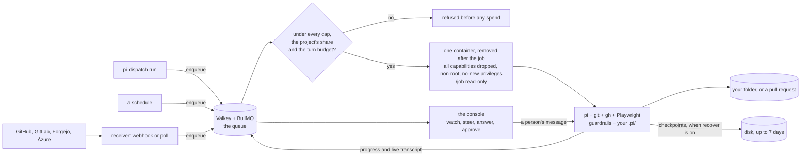

# pi-dispatch

**Hand routine software work to an AI coding agent, and decide for yourself how closely you watch it.**

pi-dispatch runs the [pi](https://github.com/earendil-works/pi) coding agent for you in the background, on your own
computer or server. You say what it should work on and when. Each job happens in a sealed box that is thrown away
afterwards, stops at the spending limit you set, and shows up live on one web page. When it works on a project on GitHub
or GitLab, you get back a proposed change to review. pi-dispatch never merges anything, so what ships stays a person's
decision.

It is free and open source. You pay your AI provider for what the agent uses, or use a subscription you already have.

## Install in four steps

**1. Have these ready.** A computer or server that stays on (on a Mac or Windows machine, jobs run only while you are logged in),
[Docker](https://www.docker.com/products/docker-desktop/) and [Node.js](https://nodejs.org) 22.19 or newer, and a key from an AI
provider or a subscription. Steps 1 and 2 are for someone comfortable in a terminal.

**2. Install it.** Into a folder that will stay there:

```bash
mkdir my-dispatch && cd my-dispatch
npm install --save-exact @edgehero/pi-dispatch@4.3.3 @edgehero/pi-dispatch-admin@4.3.3 @earendil-works/pi-coding-agent@1.5.0 --omit=dev --omit=optional --ignore-scripts --no-audit --no-fund
./node_modules/.bin/pi-dispatch up --console
```

It asks before it starts anything, then prints a sign in link that works for 60 seconds.

**3. Finish the checklist in your browser.** The link opens a live list of what is ready and what is not: the queue, a worker, the
network rules, your provider key and a first trigger. It offers recipes: fix an issue when it gets a label, tidy every night, or
answer a comment.

<details>
<summary>Prefer the terminal? What <code>pi-dispatch doctor</code> checks</summary>

</details>

**4. Bring your own pi setup, if you have one** ([below](#bring-your-own-pi-setup)), and [run a first job](#how-to-use-it). Running it on a
server for good has [its own steps](#set-up-a-host).

## Why: from in the loop to out of the loop

Working with a coding agent usually means sitting next to it. You type, it works, you check, you type again. That is
the right way to start, but one person can only watch so much. pi-dispatch lets you step back at your own pace, one kind
of work at a time, and it never asks you to trust more than you have seen.

### 1. In the loop: watch it work and step in

You start a job and follow it live: what it is doing, which step of its plan it is on, what it said. If it heads the
wrong way you tell it, and it reads your message before its next step. You do not have to start over and pay for the
same work twice.

### 2. Near the loop: it comes to you when it needs you

Now it works alone, and you hear from it only when it has a question or needs permission. A job with a question stops
and waits. Nothing runs and no model is paid for while it waits, and your answer picks the work up where it stopped. A
gate can make it ask before a named action, and a rule you write can have an answer drafted for you to read and send. A
question is the agent's own words, so your instructions decide how it asks: what it found, your options, what it recommends.

### 3. Out of the loop: you review what comes back

Now the work starts without you: on a schedule, when someone labels an issue or comments on it, or (as a read only
investigation) when an alert comes in. You read the results when it suits you. **Zero touch** tells you how far you have
come: how often runs needed a person, per project, over the last 7, 30 or 90 days.

Out of the loop does not mean out of control. The spending limits hold with nobody watching, every job stays in its
box, and a person still merges.

## Is this for you?

It works on code: a project on GitHub, GitLab, Forgejo or Azure DevOps, or a folder under git on your own machine. It fits
when the same kind of software work keeps coming back and you would rather not sit through it:

- a nightly job that tidies a code base, updates a report or sorts new issues;
- "label an issue and a proposed fix appears", for small everyday fixes;
- answering review comments on the changes the agent proposed;
- several projects sharing one queue, one budget and one page.

For a one off task on your own machine, plain pi is enough.

## Common worries

**Do I need to be a developer?** To use it day to day, mostly not: the web page is where you read what happened, answer
questions, approve, add a schedule and change limits, and you describe a recurring job in plain sentences. To set it up
you need someone comfortable in a terminal, and now and then for a setting the page does not offer. And what it hands you
is code, so someone should be able to judge it before it ships.

**Can it run up a bill?** You set limits in dollars and in jobs, per day, week and month, for everything or per project. A
job over a limit is refused before it starts, and a job with its own cap is stopped before any model call that could
take it past that cap. Also set a spending limit at your AI provider, as a last line.

**Can it break my project?** On GitHub, GitLab, Forgejo or Azure DevOps a job works on a fresh copy and comes back with a
pull request for you to review, and on GitHub pi-dispatch refuses a repository whose default branch is not protected. A job
on a folder on your own machine edits that folder directly, with no undo, so it refuses a folder with uncommitted
changes unless you force it.

**Can it reach my passwords or my other files?** A job sees only its own project, inside its box, and can reach only the
internet addresses you allow. Two secrets do go in, and the agent can read them: your AI provider key and your GitHub or
GitLab token. That is why the provider limit above matters, and why a narrow token beats your whole login
([`SECURITY.md`](SECURITY.md) says plainly what is and is not defended).

**What if the machine restarts or a job dies?** The queue is kept on disk, so waiting jobs are still there. A job that
was running is lost or started over, unless its trigger opts into continuing from its last checkpoint.

**What does it cost?** pi-dispatch is free, under the MIT license. You pay your AI provider and for the machine it runs on.
There is no typical figure, because a job's cost depends on your model and on the work, so start with a low daily limit and
read what it spent. The console shows what each project, job type, model and day cost, and whether a subscription would
pay off.

**Can I use a subscription I already pay for?** Yes, if you set it up on purpose: ChatGPT sign in, or Claude through a
community bridge (an extension that connects your subscription to pi). It never falls back to spending an API key behind your
back, and the console shows how much of your subscription's limit is left. Read your provider's terms first: whether they
allow this is theirs to say, not ours.

**What if my AI provider is down, or I hit its limit?** You can list fallback models in the order you prefer. A job that
is rate limited, out of quota or hitting an overloaded provider tries the next model on its next attempt, and that model
rests for a while before it is tried again. With no fallback, the job waits or
fails with a reason you can read, and nothing is spent on it in the meantime.

## What else it does

**Spend:** today, this week and this month against your limits, and where the money went.

**Fleet:** every machine and what it is doing, with one switch that stops new work everywhere.

**Models and fallbacks:** name a job for what it needs (a planner, an editor) and choose the model per project, with fallbacks in
order. The page shows which model is resting and why, and suggests a cheaper model with the numbers to compare.

**Your subscription's limits:** how much of its five hour and seven day windows is used, and when each resets.

**Approvals:** a job can ask permission before a named action, such as spending more. It stops and costs nothing until you decide.

**Drafted answers:** a rule you write can have the agent draft an answer to a question from sources it read. You read it, and only
you send it.

**Picking up where it stopped:** if a machine restarts or a job's box dies, a job that opted in continues from its last checkpoint
instead of paying for everything again.

**Trying it yourself:** reopen a finished job's workspace in a fresh box with no keys, or prepare one from scratch, and open it in your
own terminal or your browser.

**Updates:** which version of pi and which extensions your jobs run, what is newer, a capped trial on a real job, and Adopt. Nothing
updates by itself.

**Projects:** group your repositories into a project, with its own limits, share of the budget and history.

**A trigger:** what starts it, what it runs and what it has cost. A schedule also gets a button that fires it now.

**Your phone:** every page fits, for answering a question from wherever you are. The console listens on all IPv4 interfaces
at port `4790` by default; add the host name or IP to `PI_CONSOLE_ALLOWED_HOSTS` before opening it from another device.
The connection is plain HTTP, so use a trusted TLS proxy or an SSH tunnel on an untrusted network.

## Bring your own pi setup

Already use pi? Your models, skills, persona and extensions come along, so jobs work the way your own sessions do. Run this in the
folder you installed into, whenever your setup changes:

```bash
./node_modules/.bin/pi-dispatch import-pi --with-packages
# then, in that folder's .env, point at the copy it made:
PI_GLOBAL_PI_DIR=/absolute/path/to/my-dispatch/pi-global
./node_modules/.bin/pi-dispatch doctor     # checks that the copy holds no credential
```

| What comes along | What never does |
|---|---|
| Your custom models, as definitions only | `auth.json`, and any key written into a file (the import refuses it) |
| Your skills and persona | Your sessions, themes and settings |
| Your extensions, each listed by name as it copies them | Any extension you have turned off in pi |
| The packages you installed with `pi install`, pinned at the version you have | Anything a project asks to install: only you choose what gets installed |
| Your MCP servers, with credentials as references only | Secrets of any kind: the copy is read by jobs, so it holds none |

**Read the list it prints.** An extension is code, and it runs in every job, beside work that may come from a stranger's issue text. Skip
extensions with `--no-extensions`, or keep one trigger's jobs out of your packages with `"packages": false`.

Your projects still win. A job layers your setup under the project's own `.pi/` folder, so a project's skill replaces yours of the same
name, and a small safety floor sits under both, which neither can remove. To add a language or a system tool rather than a pi setting, build
your own job image.

## How to use it

Once it is installed, this is the path through the three stages.

**1. Run a first job and watch it.** Start the worker from the checklist. Give it a folder that is a git repository, with your
work committed, because a job on a folder edits it directly. Then open **Runs** in the console and read along. You are in
the loop.

```bash
./node_modules/.bin/pi-dispatch run ./my-project --task "add type hints" --flow tidy
```

A flow is a short text file of instructions in your project, such as `.pi/skills/tidy/SKILL.md`. The
[`examples/`](examples/) folder has one to copy.

**2. Give it a schedule or a label.** On **Triggers**, add a rule: every night at three, or whenever an issue gets the label
`pi:fix`. Turn on **steer** in the form, so you can also tell its jobs what to do while they work. To let a job stop and ask you,
add `resume` and `awaitInput` to the rule in `triggers.json`, which is a job for your technical person. You are near the loop.

**3. Step back when the numbers say you can.** Read **Zero touch** under Runs. When a kind of work rarely needs you, let
it run and review what comes back. You are out of the loop for that work, and still in charge of what ships.

To open the console again later, go to its address, or make a new sign in link with `pi-dispatch-console link --name <you>`.
A sign in lasts up to 12 hours, and an hour with nothing happening ends it sooner. After that, you need your token or a new link.

## Words used here

| Word | What it means |
|---|---|
| **Agent** | A program that uses an AI model to read code, change it and run it |
| **pi** | The open source coding agent that does the work here. pi-dispatch runs it, and adds no agent of its own |
| **Job**, or **run** | One piece of work, from start to finish |
| **Trigger** | A rule for what starts a job: a schedule, a label, a comment |
| **Flow** | A short text file in your project with the standing instructions for a kind of job |
| **Container** | The sealed box a job runs in, thrown away afterwards |
| **Forge** | The place your code lives: GitHub, GitLab, Forgejo or Azure DevOps |
| **Repository** | A project's code and its history, on a forge or in a folder (a "git repository") |
| **Pull request** | A proposed change to a repository, for a person to review |
| **Merge** | Accepting a pull request into the project. pi-dispatch never does this |
| **Issue**, **label** | A note about work to do on a forge, and a tag you can put on it |
| **Worker** | The part of pi-dispatch that takes jobs from the queue and runs them |
| **Terminal** | The window where a developer types commands |
| **Provider key** | The password-like key your AI provider gives you, which pays for what the agent uses |
| **Console** | The web page shown here |

## For engineers

Everything above in the terms you would run it by. pi has no job queue, no concurrency control, no spend limit and, by its
own README, no permission system. pi-dispatch adds exactly that layer and nothing else. It is not another agent to
compare with the one you use: it is the queue, the budget and the box around the pi you already run, steered by the
`.pi/` setup your repo already has.

> **Naming heads up.** The published packages are scoped: `@edgehero/pi-dispatch` (the `pi-dispatch` command). The bare npm
> name `pi-dispatch` belongs to an unrelated package (see [License](#license)), so outside a checkout always use the scoped
> name.

## Where it can run

pi-dispatch is a long running worker that starts containers, so it needs Node 22.19 or newer beside a container
runtime, on the same host. In a deployment the worker runs in a container and reaches the host's Docker socket
([Run it with Compose](#run-it-with-compose)); on your own machine it runs on the host.

| Where | Works? |
|---|---|
| A Linux server or VM you control (a VPS, a cloud VM, a home server) | **Yes.** The main target. Run it with Docker Compose ([Run it with Compose](#run-it-with-compose)). |
| Your own Mac or Windows machine with Docker Desktop | **Yes** for local jobs, while you are logged in, because Docker Desktop is. Not a deployment target. |
| Several machines sharing one queue | **Yes**. |
| Serverless and app platforms (Vercel functions, Netlify, Cloudflare Workers, a PaaS without a container runtime) | **No.** There is no container runtime to start jobs in, and nowhere for a worker that never stops. |
| Hosted sandbox services as the place jobs run (Vercel Sandbox, E2B, Modal, Daytona and similar) | **Not yet.** A new venue needs an adapter. |
| A Docker or Podman daemon on another machine (`DOCKER_HOST=ssh://...`) | **No.** Job files are mounted from the worker's own disk, which that machine does not have, and it would receive every job's provider key and forge token. |

Only the receiver needs to be reachable from the internet, and only for webhooks. Behind a firewall, use the receiver's
`poll` mode instead, which needs no public URL.

- **`local`**, the default: the Docker daemon, or rootful Podman through its Docker API. Easiest to set up, and the only
  choice on macOS and Windows. The worker needs the daemon's socket, and that access is equivalent to root on the host.
- **`podman`**: rootless Podman as the worker's own account, on Linux. No daemon runs as root, each job runs as the
  worker's own uid, and Valkey, the egress proxy and the worker run in containers. Pick it for a shared or security
  sensitive server.
- **`openshell`**: one NVIDIA OpenShell sandbox per job on a gateway on this host, in copy mode, so nothing of the job is
  mounted into the sandbox. The gateway's policy is the egress control, so no egress proxy starts. A provider made for each job
  holds its secrets, one per endpoint, so the agent sees placeholders rather than the values, with no secrets manager
  needed. `openshell-bind` runs the same policy with the job's folders bind mounted. `pi-dispatch doctor --openshell` checks the gateway first, and
  `up` sets it up. Pinned to OpenShell 0.1.4, since its
  interfaces are marked experimental.

Each job gets the memory and CPUs its project's row sets (4 GB and 2 CPUs by default), and starts only when its size fits
beside what already runs on that machine.

## Set up a host

A machine that runs jobs for good, rather than while you watch. **Linux with Docker Compose is the only supported
deployment.** The host needs Docker Engine with the Compose plugin and a copy of this repository at the release you
want: the compose file builds the worker and the receiver from the source beside it, so an npm install is the local
path, not this one. The worker container holds the host Docker socket, which is authority equivalent to root; run it
on a host you control, and read [`SECURITY.md`](SECURITY.md) before it faces anyone.

1. Put the checkout where it will stay. Your `.env` and `runtime/` sit beside it and are the deployment's state; an
   update replaces the source and keeps both.
2. Copy `.env.example` to `.env` and fill it in: the provider key, the forge token, `PI_SESSIONS_DIR`, and the hosts
   jobs may reach.
3. Start it with [Run it with Compose](#run-it-with-compose), then check it:

```bash
docker exec deploy-worker-1 node /opt/pi-dispatch/worker/src/cli.mjs doctor --live
```

**Reach the console from your own machine.** The compose file publishes port `4790` on all host interfaces; add that
address to `PI_CONSOLE_ALLOWED_HOSTS` in `.env`, open `http://<host-address>:4790/` and sign in with your token. The
connection is plain HTTP. For a private SSH tunnel, forward the port and make a sign-in link in the console container:

```bash
ssh -L 4790:127.0.0.1:4790 yourhost              # on your own machine; then, on the host:
docker exec deploy-console-1 node /opt/pi-dispatch/admin/src/console/cli.mjs link --name you --port 4790
```

**Connect a forge.** `pi-dispatch setup github --webhook-url '<receiver URL>'` creates a GitHub App in one browser click, or `--no-webhook`
if the host has no public address; the `receiver` profile keeps the receiver running, and `PI_RECEIVER_PUBLISH` in `.env` is the
address it answers on. GitLab, Forgejo and Azure DevOps have a [setup page each](#other-forges).

**Before it runs unattended:**

- Set a spend limit at your provider, and caps here.
- Protect the default branch of every repository it may touch: the worker refuses a GitHub repository without it.
- On a shared server, prefer `PI_BACKENDS=podman`: access to the Docker socket is equivalent to root.
- List the hosts jobs may reach, since everything else is denied.
- Use the GitHub App rather than the default `gh` source, which forwards your whole login.
- Read [`SECURITY.md`](SECURITY.md).

**Add a second machine.** Point it at the same Valkey and give every worker a name with `PI_WORKER_NAME`. Each host keeps its own logs, jobs and
sandbox folders. Run one worker per container daemon.

**Keep it working.** To restart after running jobs finish, pause the queue, wait until `status` reports no active job,
recreate the worker, then resume; `/config/updates` in the console shows what is newer.

## Providers and models

**pi-dispatch itself needs no AI key.** The queue, the caps, the containers, the console and the CLI run no model. The key
is for pi, inside each job. pi-dispatch works with most providers pi supports. Pick the default in `.env`:

```bash
PI_PROVIDER=anthropic
# an exact model version keeps cost predictable
PI_MODEL=claude-sonnet-5-5
ANTHROPIC_API_KEY=...
```

Override them for one job with `--provider` and `--model`. The worker asks pi which variable your provider reads, and
`doctor` checks that it is set. If you are logged into pi with an API key, leave it blank: the worker reads it from
`~/.pi/agent/auth.json`. Providers without a single key variable (an AWS profile for Bedrock, for example) are refused before anything is
spent. A trigger's `run.models`, or `PI_ALLOWED_MODELS`, names the models a job may call, and the job is stopped before it calls another.

### Subscriptions

A subscription you already pay for works through an explicit connection in `PI_AUTH_CONNECTIONS_FILE`, one per provider:

- **OpenAI** through Sign in with ChatGPT (`openai-chatgpt`), on the direct Responses route.
- **Claude** through a community bridge you select and stage: `pi-anthropic-oauth@0.3.6` or `@gotgenes/pi-anthropic-auth@3.4.3`, each pinned and
  checked against its published source. These are community extensions with tested compatibility, not vendor endorsed. Anthropic's
  [terms](https://code.claude.com/docs/en/legal-and-compliance#authentication-and-credential-use) separate native applications from third party
  integrations, so read them first. Whether they permit your deployment is not something this project can tell you.

```bash
pi-dispatch auth login chatgpt-main    # on the owning host: the browser sign in, and the worker keeps the renewal
pi-dispatch auth status
pi-dispatch auth usage chatgpt-main
```

The owning host keeps the refresh credentials, and a job gets only a short lived access credential. A binding owns its provider: when it is
disconnected or exhausted it never silently spends an API key, picks another account or changes the billing route. A known exhausted window holds
jobs until its reset, and the Models page shows each window. Subscription jobs need a finite `models` list and do not run on OpenShell.

### Roles and fallback models

A **role** is a name a trigger selects (`planner`, `editor`), which you map to a model per project in `triggers.json`, so moving a project to another
model is one reviewed edit.

```json
{ "run": { "kind": "github", "flow": "fix", "provider": "anthropic", "model": "claude-sonnet-5-5",
           "models": ["anthropic/claude-sonnet-5-5", "openai/gpt-4o"],
           "fallbackModels": ["openai/gpt-4o"] } }
```

**Fallbacks** are tried in order on the job's next attempt when a provider is rate limited, out of quota or overloaded. Each is chosen at pickup,
before a credential is minted, a repository cloned or budget reserved, and must pass the same checks as the primary: on `run.models`, in the pinned
catalog with a cost bound and a credential, allowed by egress, with endpoint room. A failed model cools down for a while. An attempt may call only
its selected model, so a flow that means to use several keeps its own setup.

**Proposals and canaries.** Doctor suggests a change, `pi-dispatch canary` replays up to three retained jobs on the candidate in disposable workspaces
under one cap, and the Models page shows the comparison. A person adopts it, and no model can.

## Triggers

**A trigger is what starts a job.** All standing triggers live in one `triggers.json`, which the worker and the receiver read
live, and which the console can edit. Each entry is an `{ on, run }` pair: **`on` says what fires it**, and
**`run` says what it runs**.

```jsonc
{ "triggers": [
  { "on": { "type": "cron", "id": "nightly", "pattern": "0 3 * * *" },
    "run": { "kind": "local", "folder": "/srv/site", "flow": "tidy", "task": "run the nightly tidy" } },
  { "on": { "type": "label", "any": ["pi:frontend"] },              "run": { "kind": "github", "flow": "frontend-fix" } },
  { "on": { "type": "comment", "phrase": "@pi" },                   "run": { "kind": "github", "flow": "fix" } },
  { "on": { "type": "pull_request", "action": ["labeled"], "any": ["pi:review"] }, "run": { "kind": "github", "flow": "review" } },
  { "on": { "type": "label", "any": ["pi:fix"] },                   "run": { "kind": "gitlab", "flow": "fix" } }
] }
```

| `on.type` | Fires when | The agent's task |
|---|---|---|
| `cron` | your schedule | `run.task` from the file |
| `label` | a label is added to an issue (or an Azure work item) | the issue title and body |
| `comment` | a comment contains your phrase, such as `@pi` | the comment plus the issue |
| `pull_request` | a PR or MR event, a submitted GitHub review, or a close | the PR title and body |
| `issue` | an issue closes | the issue title and body |

`run` names a `flow` or a registered pi `command`. **Who may fire a trigger is decided by your forge, not by pi-dispatch**:
[`SECURITY.md`](SECURITY.md) states each forge's rule. Each optional `run` field, in a line:

- `steer`: a running job takes messages.
- `resume`, `awaitInput`: follow up jobs continue the session, and the agent can ask and wait.
- `recover`: a lost run continues from its last checkpoint.
- `progress`, `statusComment`: the agent names its phase, and one comment on the issue keeps the numbers.
- `image`: this trigger's own job image.
- `secrets`, `secretsProfile`, `secretBundle`: vault references, and a project's one shared environment.
- `mcp`, `forge`: MCP servers for its jobs.
- `excludeTools`: removes named built in tools.
- `packages`: opts out of the staged pi packages.
- `models`, `maxCostUsd`: the models a job may call, and its own dollar cap.
- `replicas`: races independent sandboxes on one event.
- `waitFor`: holds a job, unstarted and unbilled, until a time or your own check (waiting).
- `instructions`, `skillsDir`, `github`, `portfolio`: the rest are in `triggers.example.json`'s comments.

A whole project can get one environment from your secrets manager, granted once and read fresh at each job start. Quiet
hours pause a repo or folder by weekday and timezone. The
portfolio manager example plans a budget split for the week and reports what it asked for.

## Flows: the custom prompt a trigger runs

A **flow** is a pi skill, a Markdown instruction file, committed to the target repo at `.pi/skills/<flow>/SKILL.md`. That file
is the prompt. A trigger only names the flow, so each repo can define the same flow name its own way.

```markdown
<!-- .pi/skills/tidy/SKILL.md -->
---
name: tidy
description: Format, fix lint, and tighten types across the repo.
ai-trigger: allow        # opt-in for AI-INITIATED runs only (job chaining). Default deny.
---

Run the formatter and linter and fix what they report; tighten obvious type holes.
Keep the diff minimal and open a PR titled "tidy: <what changed>". Do not change behavior.
```

The flow holds the standing instructions. The **task** is the one off request: your `--task`, a trigger's `task`, or the issue
or comment text. Flows are read from the **default branch**, so a flow must be merged before a trigger can use it. That merge
is the repo's consent. `ai-trigger` only decides which flows a model may start. It does not decide who may fire a job: a cron
or forge trigger in your reviewed `triggers.json` runs its flow either way
(flows in detail, multi stage workflows).

## What runs, and what protects you



Every trigger takes this path: spend is checked before the container starts, and nothing is dropped. Read
[`SECURITY.md`](SECURITY.md) before you rely on it.

- **Network egress is denied by default.** Each job gets its own network behind an allowlist proxy, and a job the policy cannot
  serve is refused before it spends. The allowed hosts are yours to list.
- **Token and cost records cover the whole job**, including subagent sessions and `pi` child processes, and the per job token
  budget is enforced against that same total.
- **The container runtime is a named backend** that declares what it guarantees. `pi-dispatch doctor` prints the declaration, and
  `pi-dispatch doctor --live` reads eight of those properties back from real containers.
- **Credentials.** On Docker and Podman the provider key and the forge token go in as environment values, and **the agent can read both**. The
  guardrails tell it never to print or send them, but that is prompt text, not enforcement. Bound the key with a **spend limit at
  your provider**. On GitHub the token is one hour for one repo with the App, or **your whole login, full scope and never
  expiring**, with the default `gh` source. Anything in `PI_FORWARD_ENV` has the same exposure. The limit is on the damage, not
  on the leak. None of these have to sit in a file.

## Costs, projects and capacity

**Costs.** A turn limit per job, job and token caps for the whole deployment, dollar caps per day, week and month, and a dollar
cap per job. Caps can apply per repo, folder, model or project. Every job writes a durable record with ids only, never issue or
comment text, with a usage ledger per model that the insights page prices. A zero rate run with no declared plan reads `$0 (unrated)`, never "free".

**Projects and split.** Group repos and folders into projects and cap each as one. Set a dollar total with a floor per project, and a
flow can move money between projects inside it, never above the total or below a floor. Every move is logged and can be reverted.

**Capacity.** Each machine keeps its own memory and CPU budget, and room is kept for a waiting big job so small ones cannot starve it.
The console, `pi-dispatch capacity` and `doctor` report how busy each host was. They count jobs only: a machine busy with other work
reads as idle.

**Flows map.** Which triggers start which flows, what chained to what, and what each cost.

The console also has Models, Watch, an audit log
of every write, and Configuration. Each write is a preview and a confirm, and paid and destructive ones look different.

## Reuse your existing pi setup

[Above](#bring-your-own-pi-setup) is how. Below it, four trust levels layer, most trusted first: the image's baked safety floor, the global overlay
(mounted read only at `/opt/pi-global`) with its staged packages and a trigger's `run.skillsDir`, the repo's `.pi/`, and the task text, which is never
instructions.

- **Nothing installs at job time.** Every job runs with `PI_OFFLINE=1`, so pi's resolver cannot shell out to npm. A package is staged on the host, at an
  exact version, always with `--ignore-scripts`.
- **A repo's own `.pi/extensions` do run**, because the checkout is the default branch and merging is the gate. Nothing installs packages because a repo asks.
- **MCP servers are yours, not the repo's.** A repo's `.pi/mcp.json` is never read for a job, and a trigger names the servers its jobs connect.
- **Sessions save the full transcript to disk**, which is a real disclosure: read the session notes before you turn them on.

## Run it with Compose

Deployment is Linux with Docker Compose, from a checkout of this repository. Run every command from the deployment
folder, with one `-f` and `--env-file .env`:

```bash
cd /path/to/pi-dispatch
C="docker compose --env-file .env -f deploy/docker-compose.yml"
$C --profile worker --profile console up -d     # Valkey, the worker and the console
$C --profile receiver up -d                     # the webhook receiver
$C --profile egress up -d                       # the allowlist proxy, when egress is on
$C ps                                           # what is running
```

- **`--env-file .env` is not optional.** Compose reads the Valkey password, `PI_JOB_IMAGE` and `PI_RECEIVER_PUBLISH`
  from it; without it Valkey starts with no password.
- **There is no override file.** Every setting is a key in `.env`.
- **Both built images come from this checkout.** `deploy-worker` runs the worker and the console, `deploy-receiver`
  the receiver; an update builds them again (`$C --profile worker --profile console build worker`,
  `$C --profile receiver build receiver`) and recreates the containers.
- **The job image is pulled on the host, never at job time** (jobs run `--pull=never`). Its default is
  `${PI_JOB_IMAGE:-docker.io/ddv12138/pi-job:4.3.2-5d10c5d2}`; a value in `.env` wins over it.
- **The receiver answers on `${PI_RECEIVER_PUBLISH:-127.0.0.1}:3000`.** Set it in `.env` when the host has a LAN
  address or a reverse proxy in front.
- **The worker keeps the host Docker socket.** That is authority equivalent to root, so the console and the
  receiver get none.

### Control the worker

The CLI talks to the queue, so it needs no worker process of its own. In a container deployment, run it in the worker
container; `pause` stops taking new jobs and survives restarts, `resume` takes them again, `status` prints counts,
`cancel <jobId>` stops one job in any state, `run --trigger <id>` runs one cron trigger now, and `capacity` says how
busy each host was:

```bash
docker exec deploy-worker-1 node /opt/pi-dispatch/worker/src/cli.mjs pause
```

These read only what they need, so a broken forge setting cannot stand between you and the stop.

Upgrading to a new release follows one order (pause, the job image, every worker, the receivers, the console, then resume), and the release notes say what each release changed in what it stores
and how to roll back.

## GitHub automation

Label an issue, and a container works on a fresh clone, opens a PR and comments back.

- **Only a collaborator's label, `@pi` comment or formal review starts a job.** A PR from a stranger's fork never starts a job on its
  own. A review is gated on the **reviewer**, so a collaborator reviewing that fork PR does start one.
- **The token can merge.** GitHub puts push and merge behind the same permission, so under every auth source the job's token could
  merge. pi-dispatch never does, and **branch protection on your default branch is the real control**. The worker refuses a repo
  without it, before any spend.
- **Which token a job holds depends on the auth source.** The GitHub App mints one per job, for one repo, valid for an hour. The default
  `gh` source forwards **your own login, full scope and never expiring**, and `pi-dispatch doctor` warns about that.
- **The checkout is always the base repo at its default branch**, never a PR branch. A commit that lands on your default branch can run
  code in a job. Issue and comment text never can; it stays data.

`pi-dispatch setup github` creates a GitHub App in one browser click, shows every `.env` line before you agree, and never prints a secret.
Run the part that takes in forge events as a container beside the worker, or in `poll` mode with no public URL.

## Other forges

| Forge | Webhook | Who may fire a job |
|---|---|---|
| GitLab, 17.4 or newer, self hosted through `GITLAB_URL` | `/gitlab` | Developer or higher, checked on every trigger |
| Forgejo and Gitea | `/forgejo` | Permission on that repository, read with a separate token no job sees |
| Azure DevOps | `/azure`, a Service Hook | The weakest transport of the four (no HMAC signature, no signed timestamp), so configure it carefully |

These forges have one auth source each, a token you create, so setting theirs to `app` gets a clear refusal at boot.

## How it compares

**vs the Claude Code GitHub Action**: for GitHub only automation the
[action](https://github.com/anthropics/claude-code-action) handles label triggered issues with a tenth of the setup. pi-dispatch is for
running pi on your own hardware with a real queue, a container boundary, and flows against **local folders** as well as repos.

**vs hosted routines and `/loop`**: for "run a prompt on a schedule" they are simpler, with nothing to host. pi-dispatch's cron trigger is
for recurring work that needs a project's exact toolchain, or the built in Playwright and Chromium that let a flow build a frontend and
check how it renders.

## Status

Everything on this page is built and running, on all four forges and on Docker and Podman.

## For developers

To work on pi-dispatch itself, or to build a custom job image:

```bash
git clone https://github.com/edgehero/pi-dispatch && cd pi-dispatch
npm ci
node admin/build.mjs                                # the console bundle, gitignored
valkey-server --port 6379 --save '' --daemonize yes
VALKEY_TEST_URL=redis://127.0.0.1:6379 PI_DISPATCH_REQUIRE_LOADER_TESTS=1 PI_DISPATCH_REQUIRE_WORKER_TESTS=1 \
  PI_DISPATCH_REQUIRE_RECEIVER_TESTS=1 npm test
```

Run the tests with an empty `HOME` outside the temp folder and a short `TMPDIR`: some load the real `~/.pi` setup, and unix sockets have a path limit.
They use `node:test` with hand written, injected fakes, and no network or Docker. A job image comes from `docker build -f image/Dockerfile -t pi-job:latest .`.
Jobs start with `--pull=never`, so build or pull every image first.

| Path | What it is |
|---|---|
| `worker/` | the queue consumer, the CLI (`pi-dispatch`), the forge hosts, doctor |
| `receiver/` | the always on trigger edge (`pi-dispatch-receiver`): webhook routes and the poller |
| `admin/` | the web console (`pi-dispatch-console`) |
| `gateway/` | the optional browser terminal for a sandbox |
| `image/` | the job image, and the runner inside it |
| `deploy/` | the Compose file, the worker image and the egress proxy's config |
| `docs/` | the 253 deployment runbook and the agent skills' notes |
| `launch/` | the canned deployment and browser plumbing the console tests share |

Keep pi and its packages on exact pins. Nothing in this project merges anything. Sign off commits with
`git commit -s`: this project uses the [DCO](https://developercertificate.org/), not a CLA.

Console styles live in `admin/src/console/`. See [AGENTS.md](AGENTS.md) for the agent skills and deployment notes.

## License

MIT. See [LICENSE](LICENSE). Built on [pi](https://github.com/earendil-works/pi) by Mario Zechner, which does the actual hard part.

> **Not affiliated with** the unrelated npm package `pi-dispatch`, a pi extension for rotating ChatGPT Codex OAuth accounts. Same name,
> different thing. This project publishes scoped packages only:
> [`@edgehero/pi-dispatch`](https://www.npmjs.com/package/@edgehero/pi-dispatch) (worker and CLI),
> [`@edgehero/pi-dispatch-receiver`](https://www.npmjs.com/package/@edgehero/pi-dispatch-receiver), and
> [`@edgehero/pi-dispatch-admin`](https://www.npmjs.com/package/@edgehero/pi-dispatch-admin) (the console). The bare name is theirs.
